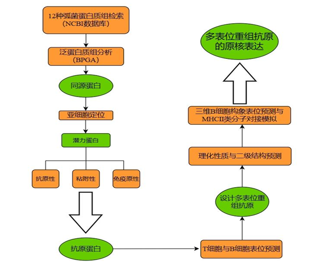
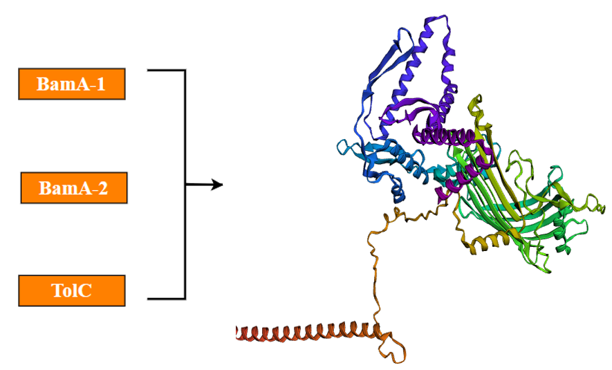
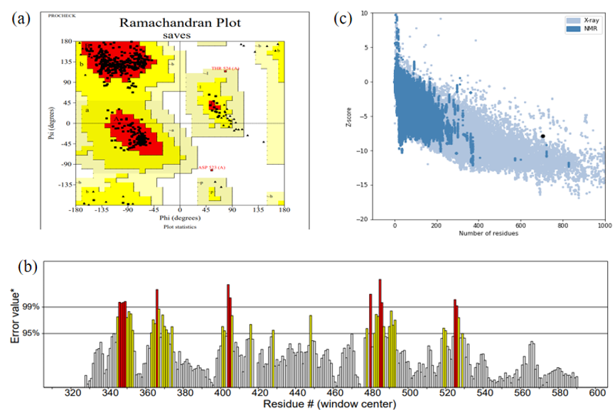
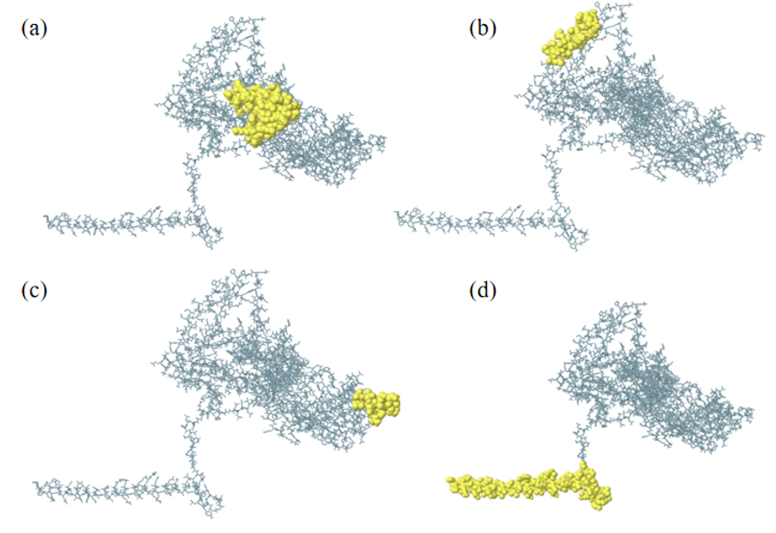
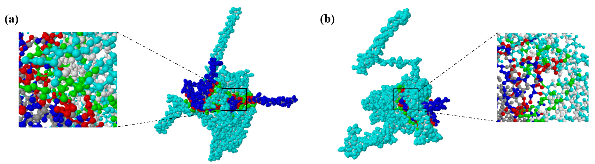
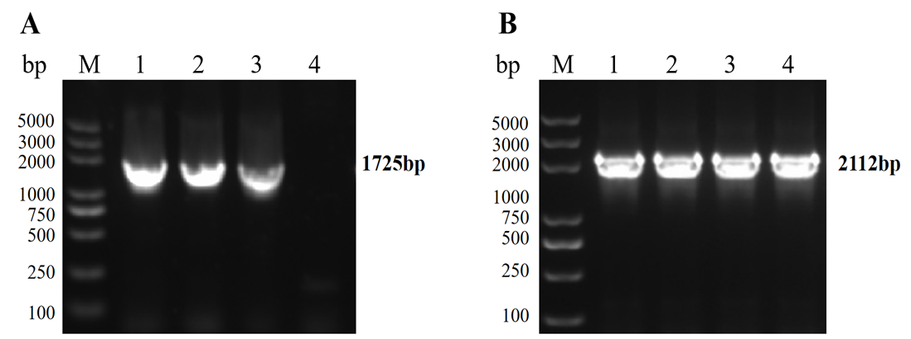
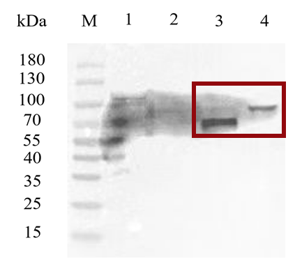
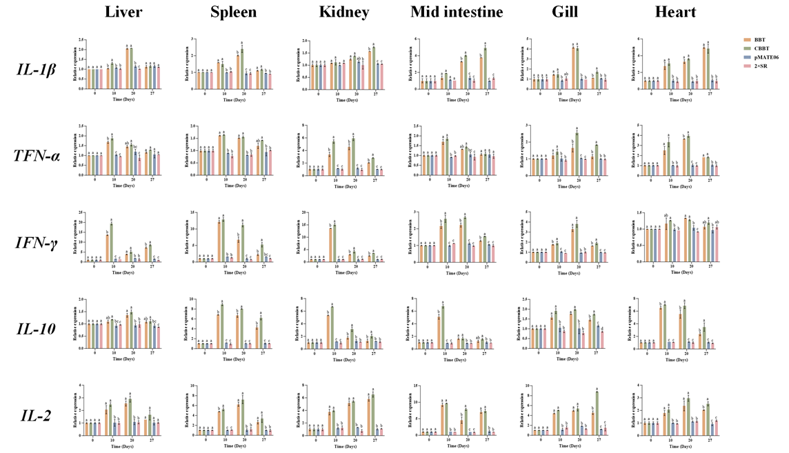
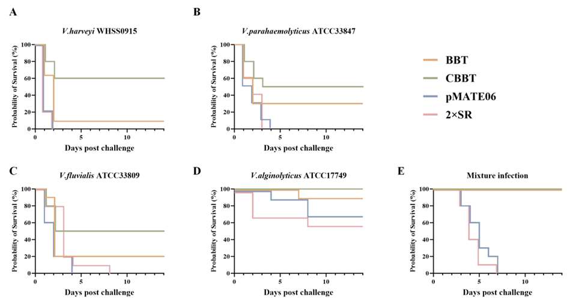

# CBBT Multi-Epitope Recombinant Antigen: Design and Evaluation

## 多表位重组抗原 CBBT：设计与评价

This repository presents the design and evaluation of **CBBT**, a multi-epitope recombinant antigen developed using reverse vaccinology and immunoinformatics. The project originated from my undergraduate research at Shandong University. It brings together the computational design route, representative structural and experimental results, and a supporting research training manual prepared at the invitation of my supervisor.

本仓库介绍基于反向疫苗学与免疫信息学策略设计的多表位重组抗原 **CBBT** 及其评价结果。项目起源于我在山东大学本科期间开展的研究，展示从计算设计到结构评价、表达验证及动物实验的项目进展。同时，受老师邀请，我将研究流程、操作步骤、代表性结果与实践经验整理为配套科研训练手册，供本科生学习和相关研究参考。

> This repository and its supporting manual are author-prepared project resources, not official publications of Shandong University.  
> 本仓库及配套手册为作者整理的项目资料，并非山东大学官方出版物。

## Project overview｜项目概述

The project explores a conserved multi-epitope antigen design strategy for broad-spectrum *Vibrio* vaccine development in aquaculture. Starting with comparative proteome analysis across 12 *Vibrio* species, it connects candidate antigen screening and epitope prediction with recombinant antigen design, structural assessment, expression verification, and animal-study evaluation.

项目面向水产养殖中的广谱弧菌疫苗研发，探索基于保守抗原与多表位组合的设计策略。从 12 种弧菌的比较蛋白质组分析出发，串联候选抗原筛选、表位预测、重组抗原设计、结构评价、表达验证及动物实验评价。

Pan-proteome analysis and screening by subcellular localization, adhesin probability, antigenicity, and immunogenicity identified **BamA** and **TolC** as candidate antigen sources. Three B-/T-cell epitope-rich segments were combined with a **CTB** molecular adjuvant, EAAAK/GPGPG linkers, and a His tag to form CBBT. Subsequent work examined its predicted structure, conformational epitopes, docking interfaces, experimental expression, and immune-related outcomes.

通过泛蛋白质组分析及亚细胞定位、黏附性、抗原性和免疫原性筛选，项目聚焦于候选抗原蛋白 **BamA** 与 **TolC**。选择其中 3 个富含 B/T 细胞表位的片段，结合 **CTB** 分子佐剂、EAAAK/GPGPG 连接子及 His 标签，组装为 CBBT；进一步评价其预测结构、构象表位、分子对接界面、实验表达及免疫相关结果。

## Workflow｜技术路线

The workflow can be summarized as:

`NCBI proteome retrieval → BPGA pan-proteome analysis → conserved-protein screening → subcellular localization → antigen-candidate evaluation → B-/T-cell epitope prediction → CBBT design → physicochemical and structural assessment → conformational epitope and MHC-II docking analysis → expression verification → immune-related gene expression and challenge-survival evaluation`

## Key results｜关键结果

The following figures highlight the main design and evaluation stages. Structural metrics and computational findings are documented in the [original project thesis](论文及参考文献/原论文.pdf); the expression and animal-study figures extend the project overview with experimental results.

以下图文展示项目设计与评价的关键结果。结构评价参数及计算分析结果见仓库中的[原始课题论文](论文及参考文献/原论文.pdf)，表达验证与动物实验图片进一步补充项目的实验结果展示。

### 1. Three-dimensional modeling and refinement｜三维模型构建与精炼

The CBBT sequence combines the BamA-1, BamA-2, and TolC-derived epitope-rich segments with the CTB adjuvant. An initial three-dimensional model was generated using **trRosetta** and refined using **GalaxyRefine**. Model IV was selected from the refined candidates for subsequent structural assessment, conformational epitope prediction, and docking analysis.

CBBT 由 BamA-1、BamA-2 和 TolC 来源的高表位密度片段与 CTB 佐剂等组成。使用 **trRosetta** 构建初始三维模型，经 **GalaxyRefine** 精炼后，选择 model IV 进行后续模型质量评价、构象表位预测和分子对接分析。

*Figure 1. Antigen-segment sources and the refined CBBT model. The source labels indicate the selected antigen segments; the rendered structure represents the assembled recombinant antigen.*  
*图 1. 抗原片段来源与精炼后的 CBBT 三维模型。左侧标示所选抗原片段的来源，右侧为组装后的重组抗原结构模型。*

### 2. Model quality assessment｜模型质量验证

The refined model was assessed using **PROCHECK/Ramachandran analysis**, **ERRAT**, and **ProSA-web**. The proportion of residues in the most favoured Ramachandran regions increased from **91.7%** before refinement to **94.1%** after refinement. The refined model had an **ERRAT score of 90.818** and a **ProSA Z-score of −7.88**. These complementary assessments supported its use in the subsequent computational analyses.

使用 **PROCHECK/Ramachandran 分析**、**ERRAT** 和 **ProSA-web** 从不同角度评价模型质量。精炼后，Ramachandran 最有利区域的残基比例由 **91.7%** 提升至 **94.1%**；精炼模型的 **ERRAT 评分为 90.818**，**ProSA Z-score 为 −7.88**。这些评价结果为后续计算分析中的模型选择提供了依据。

*Figure 2. Quality assessment of the refined CBBT model: (a) Ramachandran plot; (b) ERRAT residue-level assessment; (c) ProSA Z-score in relation to experimentally determined structures.*  
*图 2. 精炼后 CBBT 模型的质量评价：(a) Ramachandran 图；(b) ERRAT 残基水平评价；(c) ProSA Z-score 与实验解析结构的参照分布。*

### 3. Conformational B-cell epitopes｜B 细胞构象表位

**IEDB ElliPro** predicted **eight discontinuous B-cell epitopes involving 216 residues** at a score threshold of 0.7. Representative predicted epitopes were distributed across the CTB, BamA-1, BamA-2, and TolC-derived regions, showing how the assembled antigen presents candidate epitopes in its modeled three-dimensional structure.

**IEDB ElliPro** 在评分阈值为 0.7 时，预测到 **8 个不连续 B 细胞表位，涉及 216 个残基**。代表性预测表位分布于 CTB、BamA-1、BamA-2 和 TolC 来源区域，展示了组装后抗原在预测三维结构中的候选构象表位分布。

*Figure 3. Representative predicted conformational B-cell epitopes, highlighted in yellow: (a) CTB region; (b) BamA-1 region; (c) BamA-2 region; (d) TolC-3 region. These four panels illustrate selected epitopes rather than the complete set of eight predictions.*  
*图 3. 代表性预测 B 细胞构象表位以黄色标示：(a) CTB 区域；(b) BamA-1 区域；(c) BamA-2 区域；(d) TolC-3 区域。四个分图展示部分代表性表位，并非全部 8 个预测表位。*

### 4. Docking with Atlantic salmon MHC class II chains｜与大西洋鲑 MHC Ⅱ 类分子链的对接

The refined CBBT model was docked separately with the **α and β chains of Atlantic salmon MHC class II** using **GRAMM**, followed by interface analysis with **PDBePISA**. The reported interfaces contained 21 hydrogen bonds and 14 salt bridges for the α-chain model, and 10 hydrogen bonds and two salt bridges for the β-chain model. These exploratory protein-level docking results describe candidate contact interfaces.

使用 **GRAMM** 将精炼后的 CBBT 模型分别与**大西洋鲑 MHC Ⅱ 类分子的 α 链和 β 链**对接，并通过 **PDBePISA** 分析界面。原论文报告，α 链对接模型界面包含 21 个氢键和 14 个盐桥，β 链模型包含 10 个氢键和 2 个盐桥。这些探索性的蛋白水平对接结果展示了候选接触界面。

*Figure 4. Predicted complexes and enlarged contact interfaces for CBBT with Atlantic salmon MHC-II (a) α chain and (b) β chain. Cyan denotes CBBT, blue denotes the MHC-II chain, and green/red highlight interface residues of CBBT/the MHC-II chain, respectively.*  
*图 4. CBBT 与大西洋鲑 MHC Ⅱ 类分子 (a) α 链和 (b) β 链的预测复合物及局部接触界面。青色表示 CBBT，蓝色表示 MHC Ⅱ 链，绿色和红色分别标示 CBBT 与 MHC Ⅱ 链的界面残基。*

### 5. Construct and expression verification｜构建与表达验证

Electrophoresis showed bands at approximately **1725 bp** and **2112 bp**, corresponding to the BBT control and CBBT coding fragments, respectively. The project also includes expression verification in a recombinant **Bacillus subtilis** system, with Western blot signals supporting expression of BBT and CBBT. This expression system is presented separately from the initial *Escherichia coli* expression work documented in the undergraduate thesis.

电泳结果显示约 **1725 bp** 和 **2112 bp** 的条带，分别对应对照抗原 BBT 与 CBBT 的编码片段。项目还展示了重组**枯草芽孢杆菌**体系中的表达验证，Western blot 信号支持 BBT 与 CBBT 的表达。此处展示的表达体系与本科课题论文中记录的初期**大肠杆菌**表达工作分别说明。

*Figure 5. Electrophoretic verification of the coding fragments: (A) BBT, approximately 1725 bp; (B) CBBT, approximately 2112 bp. M denotes the DNA marker; the original lane numbering is retained.*  
*图 5. 编码片段的电泳验证：(A) BBT，约 1725 bp；(B) CBBT，约 2112 bp。M 为 DNA 分子量标准，保留原始泳道编号。*

*Figure 6. Western blot verification of BBT and CBBT expression in the recombinant B. subtilis system. M denotes the protein marker.*  
*图 6. 重组枯草芽孢杆菌体系中 BBT 与 CBBT 的 Western blot 表达验证。M 为蛋白分子量标准。*

### 6. Immune-related gene expression｜免疫相关基因表达

The animal-study results compare expression profiles of **IL-1β, TNF-α, IFN-γ, IL-10, and IL-2** across the liver, spleen, kidney, mid intestine, gill, and heart. The panels show tissue- and time-dependent response patterns among the BBT, CBBT, pMATE06, and 2×SR groups, extending the evaluation from antigen expression to immune-related readouts.

动物实验比较了肝、脾、肾、中肠、鳃和心脏中 **IL-1β、TNF-α、IFN-γ、IL-10 和 IL-2** 的表达情况。图中呈现 BBT、CBBT、pMATE06 和 2×SR 各组随组织与时间变化的表达模式，将评价从抗原表达延伸至免疫相关指标。

*Figure 7. Relative expression of five immune-related genes across six tissues and the indicated sampling days. Colours distinguish the BBT, CBBT, pMATE06, and 2×SR groups.*  
*图 7. 五个免疫相关基因在六种组织及图示采样时间点的相对表达，不同颜色表示 BBT、CBBT、pMATE06 和 2×SR 各组。*

### 7. Survival following Vibrio challenge｜弧菌感染后的存活表现

Survival curves compare the experimental groups following challenges with ***V. harveyi, V. parahaemolyticus, V. fluvialis, V. alginolyticus***, and a mixed infection. Under the displayed conditions, the CBBT group showed higher final survival than the plotted controls, with outcomes varying by challenge condition. These observations provide experimental support for further development of the broad-spectrum antigen strategy.

存活曲线比较了各组在**哈维氏弧菌、副溶血弧菌、河流弧菌、溶藻弧菌及混合感染**条件下的表现。在图示条件下，CBBT 组的最终存活率高于所展示的对照组，且结果随感染条件而变化。这些观察为广谱抗原策略的进一步开发提供了实验依据。

*Figure 8. Survival after challenge: (A) V. harveyi WHSS0915; (B) V. parahaemolyticus ATCC33847; (C) V. fluvialis ATCC33809; (D) V. alginolyticus ATCC17749; (E) mixed infection. Group colours follow the legend.*  
*图 8. 感染后的存活曲线：(A) 哈维氏弧菌 WHSS0915；(B) 副溶血弧菌 ATCC33847；(C) 河流弧菌 ATCC33809；(D) 溶藻弧菌 ATCC17749；(E) 混合感染。分组颜色见图例。*

## Repository contents｜仓库内容

| Path | English description | 中文说明 |
|---|---|---|
| `序言.docx` | Purpose, scope, and suggested use of the manual | 手册定位、整体内容与使用建议 |
| `一.泛蛋白质组分析/` | Proteome retrieval, BPGA analysis, conserved-protein data, and representative outputs | 蛋白质组获取、BPGA 泛蛋白质组分析、保守蛋白数据与结果 |
| `二.抗原蛋白筛选/` | Sequential screening by localization, adhesin probability, antigenicity, and immunogenicity | 基于亚细胞定位、黏附性、抗原性与免疫原性的递进筛选 |
| `三.抗原表位预测/` | B-cell, CTL, and HTL epitope prediction and integration | B 细胞、CTL 与 HTL 表位预测及整合 |
| `四.重组抗原设计/` | CBBT amino-acid architecture, linkers, adjuvant, and nucleotide-sequence design | CBBT 氨基酸结构、连接子、佐剂及核苷酸序列设计 |
| `五.重组抗原质量评估/` | Physicochemical properties, secondary structure, 3D modeling, model assessment, docking, and PDB results | 理化性质、二级结构、三维建模、模型评价、分子对接与 PDB 结果 |
| `六.实验部分/` | Primer design, cloning strategy, prokaryotic expression, and experimental records | 引物设计、克隆策略、原核表达及实验记录 |
| `论文及参考文献/` | The original project paper, concise version, and a reference index | 原始课题论文、精简版论文及参考文献索引 |
| `assets/` | Figures used by this README | README 使用的图像资源 |

## Suggested reading order｜建议使用顺序

1. Read `序言.docx` to understand the training objectives and the relationship between computational prediction and experimental validation.
2. Follow Chapters 1–5 in order to reproduce the computational design route.
3. Use Chapter 6 only after reviewing the experimental plan, relevant biosafety requirements, and laboratory-specific standard operating procedures with a qualified supervisor.
4. Treat the supplied results as worked examples. Re-run analyses with current databases, software versions, parameters, and appropriate controls for any new research question.

建议先阅读 `序言.docx`，再依次完成第一至第五章的预测分析；进入第六章实验部分前，应在指导教师指导下核对实验方案、生物安全要求及所在实验室的标准操作流程。仓库中的结果用于展示完整思路，新课题应基于最新数据库、软件版本、参数设置和适当对照重新分析。

## Software and online services｜软件与在线服务

The manual refers to resources such as NCBI, BPGA, PSORTb, CELLO, Vaxign2, VaxiJen, ANTIGENpro, IEDB tools (including ElliPro), ABCpred, PSIPRED, trRosetta, GalaxyRefine, PDBsum, SAVES, ProSA-web, AlphaFold DB, GRAMM/ZDOCK, PDBePISA, DNASTAR, and SnapGene. Availability, interfaces, URLs, algorithms, and recommended settings may change over time.

For legal, security, and repository-size reasons, third-party software installers, password files, and third-party article full texts are not distributed in this repository. Obtain software and literature through official websites, institutional subscriptions, or other authorized channels. Software-use notes retained in the repository are provided only as historical workflow references.

手册涉及的数据库、在线服务器和软件可能随时间更新。出于软件授权、信息安全、文献版权及 GitHub 文件大小限制的考虑，本仓库不分发第三方软件安装包、密码文件或第三方论文全文；请通过官方网站、学校图书馆或其他合法渠道获取。仓库保留的软件使用说明仅用于还原当时的研究流程。

## Scope and limitations｜适用范围与局限

- This repository presents project results and supporting training materials. Computational predictions, expression verification, and animal-study observations provide different levels of evidence and should be interpreted within their respective experimental conditions.
- In-silico predictions are sensitive to database versions, algorithms, thresholds, species differences, sequence quality, and model assumptions, and therefore require independent validation.
- The example contains decisions specific to the original CBBT project. They should not be copied into a new antigen-design project without biological justification.
- Wet-lab work must be performed under qualified supervision and applicable institutional biosafety and ethical requirements.

- 本仓库展示项目结果及配套科研训练资料。计算预测、表达验证与动物实验观察属于不同层次的证据，应结合各自实验条件解释。
- 计算预测受数据库版本、算法、阈值、物种差异、序列质量和模型假设影响，必须进行独立验证。
- 手册中的部分选择服务于原 CBBT 课题，不应在缺乏生物学依据的情况下直接套用于其他抗原设计。
- 实验操作应在专业人员指导下，并遵守所在机构的生物安全与伦理规范。

## Citation and reuse｜引用与使用

If this repository contributes to your training or research, please cite the original project paper where appropriate and link to this repository. For complete bibliographic details of the supporting literature, consult the bibliography in the project paper and the reference index included in this repository.

如本仓库对科研训练或研究工作有所帮助，请在适当位置引用原课题论文并附上本仓库链接。支撑文献的完整书目信息请以课题论文参考文献表及仓库中的参考文献索引为准。

## Author's note｜作者说明

This manual records one undergraduate research route and the lessons learned while carrying it out. Its purpose is not to prescribe a single “correct” pipeline, but to help new students understand why each step is performed, reproduce the logic, identify limitations, and develop better solutions of their own.

本手册记录的是我在山东大学本科就读期间完成的一项课题的研究路径及实践经验。它并非规定唯一“正确”的流程，而是希望帮助后来者理解每一步为什么要做、如何复现其逻辑、如何识别局限，并在此基础上形成更好的研究方案。
